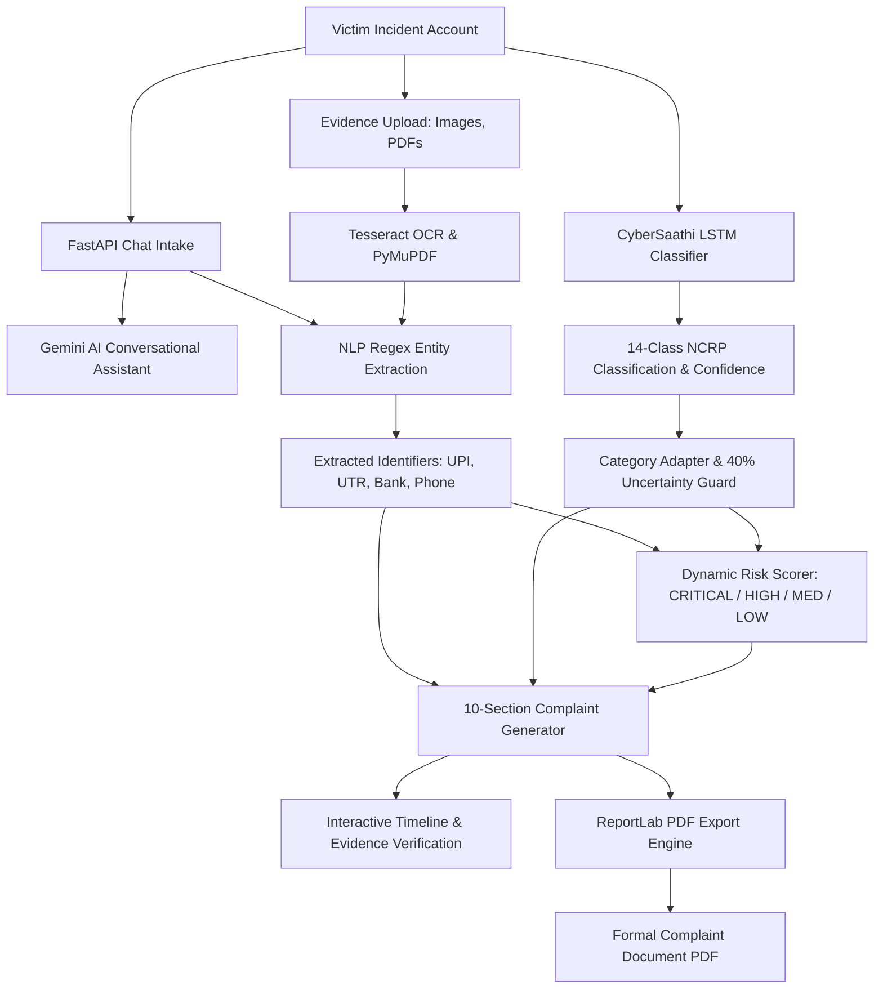

# 🛡️ CyberSaathi — AI-Powered Cyber Crime Complaint & Assistance System

<p align="center">
  
  
  
  
  
</p>

<p align="center">
  <!-- Core Language & Backend -->
  
  
  
  
  

  <!-- Frontend Ecosystem -->
  
  
  
  
  

  <!-- AI, NLP, ML & OCR -->
  
  
  
  
</p>

---

## 📌 Overview

**CyberSaathi** is an AI-powered conversational assistance and automated complaint preparation platform for victims of cybercrime in India. The application guides victims through a supportive, empathetic intake interview, extracts structured forensic identifiers (amounts, UPI IDs, bank accounts, transaction IDs, phone numbers, URLs), assesses case urgency, and generates a verified, formal **10-section cybercrime complaint document (PDF)** ready for submission on the National Cyber Crime Reporting Portal (NCRP) or at local police stations.

---

## 🧠 Primary Machine Learning Architecture: CyberSaathi LSTM

The primary live classifier in CyberSaathi is a pre-trained **Deep Learning Long Short-Term Memory (LSTM)** neural network configured specifically for multi-class cybercrime narrative classification.

### Architecture Specifications
- **Model Framework**: Keras / TensorFlow (`Sequential`)
- **Input Representation**: Natural language incident narrative
- **Vocabulary Size**: 30,000 words
- **Maximum Sequence Length (`MAX_LEN`)**: 200 tokens
- **Architecture Pipeline**:
  $$\text{Input Tokens} \longrightarrow \text{Embedding (30,000} \to \text{128)} \longrightarrow \text{SpatialDropout1D (0.2)} \longrightarrow \text{LSTM (64 units)} \longrightarrow \text{Dense (64, ReLU)} \longrightarrow \text{Dropout (0.2)} \longrightarrow \text{Dense (14, Softmax)}$$
- **Total Parameters**: 11,683,436 (Trainable: 3,894,478)
- **Primary Model Artifact**: [`cybersaathi_lstm_unweighted/cybersaathi_lstm_unweighted.keras`](cybersaathi_lstm_unweighted/cybersaathi_lstm_unweighted.keras) (44.6 MB)

### 14 Official Output Categories (NCRP Taxonomy)
1. `Any Other Cyber Crime`
2. `Child Pornography CPChild Sexual Abuse Material CSAM`
3. `Cryptocurrency Crime`
4. `Cyber Attack/ Dependent Crimes`
5. `Cyber Terrorism`
6. `Hacking  Damage to computercomputer system etc`
7. `Online Cyber Trafficking`
8. `Online Financial Fraud`
9. `Online Gambling  Betting`
10. `Online and Social Media Related Crime`
11. `Ransomware`
12. `RapeGang Rape RGRSexually Abusive Content`
13. `Sexually Explicit Act`
14. `Sexually Obscene material`

---

## ⚖️ Scientific Integrity & Reproducible Evaluation

To prevent data leakage and provide genuine, honest academic evaluation:
- The deployed LSTM was trained on an extensive corpus of ~71,422 complaints.
- Metrics are **not fabricated** and synthetic data is **not substituted** for a formal test set.
- The project includes a dedicated, reproducible evaluation engine ([`backend/app/ml/evaluate_lstm.py`](backend/app/ml/evaluate_lstm.py)) that computes:
  - Overall Test Accuracy
  - Macro Precision, Recall, and F1-score
  - Weighted F1-score
  - Per-class breakdown with support count for all 14 categories (using `scikit-learn` with safe zero-division handling)
  - 14×14 Confusion Matrix

### Running LSTM Evaluation:
```bash
cd backend
python -m app.ml.evaluate_lstm --test-data path/to/held_out_test_set.csv
```
*(Expected CSV columns: `text` or `complaint_text`, and `category` or `crime_category` matching the 14 classes)*

---

## 🚀 Key Modules & System Workflow



---

## 📁 Repository Structure

```text
CyberSathi/
├── cybersaathi_lstm_unweighted/        # Pre-trained LSTM Deep Learning Model & Artifacts
│   ├── cybersaathi_lstm_unweighted.keras # Keras model weights (44.6 MB)
│   ├── tokenizer.pkl                   # Text tokenizer (30k vocab)
│   ├── label_encoder.pkl               # 14-class NCRP label encoder
│   └── config.json                     # MAX_LEN configuration (200 tokens)
├── backend/
│   ├── app/
│   │   ├── main.py                     # FastAPI application entrypoint & CORS
│   │   ├── api/                        # auth, chat, complaint, evidence, ml routers
│   │   │   └── models_comparison.py    # LSTM evaluation & sandbox endpoint
│   │   ├── core/                       # config, database, JWT security
│   │   ├── ml/
│   │   │   ├── lstm_classifier.py      # Primary LSTM inference singleton
│   │   │   ├── evaluate_lstm.py        # Reproducible scikit-learn evaluation engine
│   │   │   ├── category_adapter.py     # 14-class to legacy DB schema compatibility
│   │   │   ├── ner_extractor.py        # Regex & pattern entity extraction
│   │   │   └── risk_scorer.py          # Financial & urgency weighted risk scoring
│   │   ├── models/                     # SQLAlchemy async database models
│   │   └── services/                   # Gemini co-pilot, complaint gen, PDF export
│   ├── tests/
│   │   ├── test_lstm_and_integration.py# 17 backend unit and workflow tests
│   │   ├── test_lstm_evaluation.py     # 7 evaluation engine & API tests
│   │   └── verify_live.py              # End-to-end live server validation
│   └── requirements.txt
├── frontend/
│   ├── src/
│   │   ├── pages/
│   │   │   ├── MLDashboard.jsx         # Model Insights & Evaluation page
│   │   │   ├── Chat.jsx                # Conversational complaint intake
│   │   │   ├── Complaint.jsx           # Structured complaint review
│   │   │   ├── Dashboard.jsx           # Case workspace
│   │   │   └── Evidence.jsx            # Document upload & OCR
│   │   ├── components/                 # Navbar, EntityPanel, RiskBadge, etc.
│   │   └── store/                      # Zustand state management
│   ├── vite.config.js                  # Vite dev server & /api proxy
│   └── package.json
├── docker-compose.yml                  # PostgreSQL database container
├── start_dev.bat                       # One-click Windows development launcher
├── .gitignore                          # Protected exclusion rules
├── .env.example                        # Template environment variables
└── README.md
```

---

## 🖥️ Getting Started Locally

### Prerequisites
- Python `3.10` or higher
- Node.js `18` or higher
- *(Optional)* Tesseract OCR for document screenshot scanning

### 1. One-Click Launch (Windows)
```powershell
.\start_dev.bat
```
This automatically launches:
- **Backend API**: `http://localhost:8000` (Docs: `http://localhost:8000/api/docs`)
- **Frontend App**: `http://localhost:5173`

---

### 2. Manual Step-by-Step Launch

#### A. Backend Setup
```bash
cd backend
python -m venv venv

# Windows:
venv\Scripts\activate
# Linux/macOS:
source venv/bin/activate

pip install -r requirements.txt
cp ../.env.example .env

# Run FastAPI server:
uvicorn app.main:app --reload --host 0.0.0.0 --port 8000
```

#### B. Frontend Setup
```bash
cd frontend
npm install
npm run dev
```
Open **`http://localhost:5173`** in your browser.

---

### 3. Running Backend Tests
```bash
cd backend
venv\Scripts\python.exe -m pytest tests\
```
*All 24 automated tests pass (covering LSTM loading, 14 classes, thresholding, risk scoring, evaluation engine, and API endpoints).*

---

## 📞 Emergency Assistance Hotlines

| Organization | Contact | Portal |
| :--- | :---: | :--- |
| **National Cybercrime Helpline** | **📞 1930** | [cybercrime.gov.in](https://cybercrime.gov.in) |
| **RBI Financial Ombudsman** | **14448** | [bankingombudsman.rbi.org.in](https://bankingombudsman.rbi.org.in) |
| **CERT-In Emergency Response** | **1800-11-4949** | [cert-in.org.in](https://cert-in.org.in) |

---

## 📜 License

This project is licensed under the **MIT License**.
